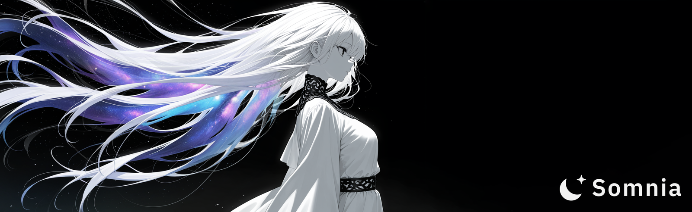

<p align="center">
  
</p>

<p align="center">
  <b>A local image generation studio for Illustrious and Anima.</b><br />
  Great results with the default settings, a smart inpainter, and a UI that works just as well on your phone.
</p>

<p align="center">
  
  
  
  <a href="LICENSE"></a>
</p>

<p align="center">
  
  
  
  
  
</p>

<br />

## Quick start

You need git and an NVIDIA GPU with about 12 GB of VRAM, on Windows 10/11 or Linux.

### Windows
```pwsh
git clone https://github.com/somniagen/somnia/
./install.bat
./run.bat
```

### Linux
```sh
git clone https://github.com/somniagen/somnia/
./install.sh
./run.sh
```

Somnia opens at **http://127.0.0.1:7865**. Put your checkpoints in `./models`. An existing ComfyUI install is found automatically (next to Somnia, in your home folder or at a drive root); otherwise set `COMFYUI_PATH` or add its models folder under Settings > Storage.

## Features

### Good images without the fiddling

- Tuned defaults for **WAI-Illustrious-SDXL v17** and **Anima-2.9B**, so the first generation already looks right
- **Hires fix, detailers and upscalers** built in: fix faces and hands automatically, then upscale to 2x or 4x
- **LoRAs** with their trigger words suggested for you, plus PAG and every common sampler
- **Live previews** that show the real composition after a few steps, not a noisy blur
- Runs comfortably on a **12 GB card**, and a locked seed gives you the same image back every time
- **Variations** of an image you like, and **X/Y/Z grids** to compare samplers, CFG, LoRA weights or prompt words side by side

### A prompt box that helps

- **Danbooru tag autocomplete**, with tags colored by type and their wiki on hover
- **Related tag suggestions**: hover a character and add their usual outfit in one click
- **Ctrl + ↑ / ↓** raises or lowers a tag's weight
- **Lock your boilerplate** (quality tags, negatives, a character description) so it stays out of your way, and comes back when you reuse an image

### Inpainting that is actually pleasant

- A **smart brush**: scribble over something and the selection snaps to its edges. A second brush removes parts just as easily
- **Auto-select faces, hands and more** with one click
- See exactly which area gets repainted, and watch the result appear inside it live
- Every attempt is kept, so you can compare versions and keep going from the best one
- The Photoshop shortcuts you already know

### A gallery you can find things in

- **Search** by tags, model, LoRA or seed, filter by model and sort however you like
- Inpainted versions are grouped with their original instead of flooding the grid
- **Reuse** any image's settings, send it to img2img or upscale it again in one click. Dropping in images from other UIs works too
- **Open in Photoshop, Krita or Paint.NET**, and your saved edits come straight back into the gallery
- **Remove backgrounds** in one click with ToonOut, a background remover trained on anime, hair strands included
- **Favorites and albums**, and a **compare** view with a slider and a diff of the two prompts

### Models, built in

- **Browse and download from Civitai** without leaving the app, with example images and the prompts that made them
- **Download from Hugging Face** too, filtered to what you need: checkpoints, LoRAs, VAEs, upscalers, or bbox and segm detectors for the detailer
- Local models are **identified automatically**, and you get a badge when a newer version is out
- Uses your existing ComfyUI folders as they are

### Use it from anywhere

- Queue up work and **watch it render from your phone** or any other device on your network
- Switching devices or closing a tab never interrupts a generation
- A proper mobile layout, not a shrunken desktop page
- Install it to your home screen and **get notified** when the queue finishes
- Optional password for other devices on your network

### Make it your own

- **Plugins** add pages, image actions, API routes and generation hooks. Drop a folder into `plugins/`, and every save reloads it live, without restarting anything. See the [plugin docs](https://github.com/somniagen/somnia/wiki/Plugins)

## License

Somnia is released under the [MIT License](LICENSE).
